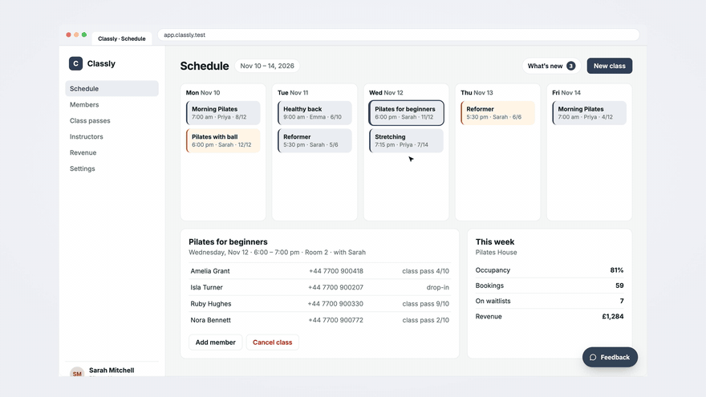

# Ozvi

Source-available bug reports and an idea board that look like your product.

[Website](https://ozvi.io/?utm_source=github&utm_campaign=readme) · [Live demo](https://ozvi.io/en/demo?utm_source=github&utm_campaign=readme) · [Docs](https://ozvi.io/docs/widget) · [Videos](https://www.youtube.com/@ozviapp) · [`@ozvi/widget`](https://www.npmjs.com/package/@ozvi/widget) · [`@ozvi/sdk`](https://www.npmjs.com/package/@ozvi/sdk)



- **Two spaces.** A private bug flow with automatic context (page, app version, browser, console errors, a screenshot with form values, e-mails, phone numbers and card numbers covered in the browser) and a public idea board with voting, roadmap and changelog.
- **Closing the loop.** "Fixed in 2.15.1 — does it work for you?" goes to the reporter, linked GitHub issues and releases set it for you, and publishing a changelog entry e-mails everyone who voted.
- **Your design.** One `theme.json` (colours, fonts, radius, density) styles the board, the widget and the e-mails.
- **Your login.** Users stay signed in from your app via a signed token or OIDC; boards can also offer sign-in by e-mailed code.
- **Your tools.** A built-in MCP server (personal tokens or OAuth connectors) lets Claude and other agents search, summarise, triage and publish — with confirmation for anything irreversible and user text always handed over as data. Webhooks for Slack, Discord or your backend.
- **Optional AI.** Duplicate detection (embeddings via any OpenAI-compatible endpoint, or fuzzy text matching with none), thread summaries, changelog drafts and a weekly team digest written by the model you choose: Claude natively or any OpenAI-compatible API (OpenAI, Mistral, Ollama, vLLM…).

Self-hosting is free with every feature (FSL-1.1-ALv2, see Licence). The same image runs the hosted cloud.

## Embed in your app

```html
<script src="https://feedback.example.com/widget.js" defer></script>
<ozvi-widget project="myapp" token-url="/api/ozvi-token" app-version="1.4.0"></ozvi-widget>
```

```ts
// npm i @ozvi/sdk   (MIT, zero deps; Python and PHP without a library: ozvi.io/docs/widget#sign-in)
import { signOzviToken } from "@ozvi/sdk";
app.get("/api/ozvi-token", requireLogin, (req, res) =>
  res.json({ token: signOzviToken({ id: req.user.id, email: req.user.email, name: req.user.name }, process.env.OZVI_SSO_SECRET) }));
```

Screenshots cover form values, e-mails, phone numbers, IBANs, card numbers and tokens on their own; mark anything else sensitive (names, notes) with `data-ozvi-mask`, or set `OzviConfig.mask = "all"` to cover all text. More: [docs/INTEGRACIA.md](docs/INTEGRACIA.md).

## Self-host

```sh
cd deploy && cp .env.example .env && docker compose up -d
docker compose exec ozvi node ozvi.mjs project:create myapp "My app" --origin https://app.example.com
```

Images are public on `ghcr.io/xzamiska/ozvi` (amd64 and arm64; tags such as `1.2.8`, `1.2`, `1`, `latest`). An optional updater container backs up the database, installs a new version on request or at night and rolls back when it is not healthy. Release notes: [ozvi.io/releases](https://ozvi.io/releases).

See [docs/SELFHOST.md](docs/SELFHOST.md). Moving from Fider: [docs/MIGRACIA-Z-FIDERU.md](docs/MIGRACIA-Z-FIDERU.md). Cloud mode: [docs/CLOUD.md](docs/CLOUD.md). Decisions: [docs/adr](docs/adr/README.md).

Optional: `OZVI_AI_PROVIDER` (`anthropic` or `openai` for any OpenAI-compatible API) + `OZVI_AI_API_KEY` + `OZVI_AI_MODEL` turn on AI writing help (see [docs/SELFHOST.md](docs/SELFHOST.md)); `OZVI_EMBEDDINGS_URL` + `OZVI_EMBEDDINGS_MODEL` turn on embedding-based duplicates.

## Connect an AI assistant

```sh
claude mcp add --transport http ozvi https://feedback.example.com/mcp --header "Authorization: Bearer ozvi_pat_…"
```

Or add `https://feedback.example.com/<project>/mcp` as a custom connector in Claude — sign-in and consent happen on the board. Tools: [packages/mcp/README.md](packages/mcp/README.md).

## Develop

```sh
pnpm install
cp .env.example .env
pnpm dev            # Postgres 17 + Mailpit in Docker, migrations, web on :3300
pnpm test
```

With `pnpm dev` and `OZVI_DEV_LOGIN=1` (in `.env.example`): http://localhost:3300/dev/login?project=billiwo&as=team signs you in as an admin, http://localhost:3300/demo shows the widget inside a fake host app, Mailpit is on http://localhost:8046.

| Path | What |
|---|---|
| `apps/web` | Next.js board, roadmap, changelog, admin, `/app` (cloud), widget API, MCP, workers, Fider importer |
| `packages/db` | Drizzle schema and migrations (Postgres 17) |
| `packages/theme` | `theme.json` schema, presets, CSS variables, contrast checks |
| `packages/sdk` | `signOzviToken` for host-app SSO (MIT) |
| `packages/widget` | Embeddable `<ozvi-widget>` (Preact, shadow DOM, ~10 kB gzip) |
| `packages/mcp` | MCP tools served at `/mcp` |

## Licence

[FSL-1.1-ALv2](LICENSE) (Functional Source License, Apache 2.0 future licence): use, modify and self-host Ozvi for any purpose except offering it as a competing commercial service. Each release becomes Apache 2.0 two years after it is published.

`packages/sdk` and `packages/widget` are MIT so they can ship inside closed-source host apps.
